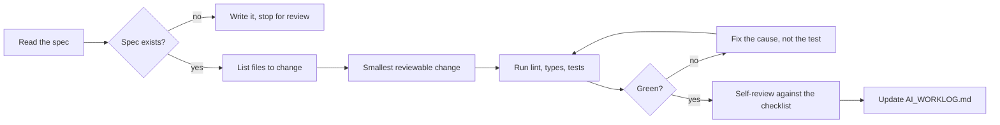

# Agent instructions

Agent-agnostic version of [CLAUDE.md](CLAUDE.md). Applies to Claude Code, Codex, Cursor, Copilot
Workspace, or any other coding agent pointed at this repository.

## Contract

An agent working here is a contributor with the same obligations as a human one, minus the ability to
be accountable afterwards. The rules exist to close that gap.

## Setup

```bash
pnpm install
pnpm verify
```

If `pnpm verify` is not green on a clean checkout, stop and report that. Do not begin work on top of
a broken baseline.

## Order of operations



## Boundaries

| Action | Allowed |
|--------|---------|
| Add or fix tests | Yes |
| Refactor within a layer | Yes |
| Add a domain rule with a spec | Yes |
| Change a contract schema | Only with explicit approval |
| Add a runtime dependency | Only with explicit approval |
| Change auth, retention or deletion behaviour | Only with a spec and a threat note |
| Commit a secret | Never |
| `git push` | Never without being asked |
| Deploy, or create a cloud resource | Never |
| Publish to an app store | Never |
| Weaken a check to make a test pass | Never |
| Delete a failing test | Never |

## Definition of done for an agent task

- The specification exists and predates the implementation in the history
- Lint, type-check and every test pass, with real output pasted
- The failure path is tested, not only the happy path
- Authorisation is checked in the service layer for any new read or write
- Nothing sensitive was added to a log, an audit record or an error message
- Every mutation carries an expected version, or the pull request says why not
- `AI_WORKLOG.md` records what was rejected and what was corrected
- The diff is small enough that a human can actually review it

## Things agents get wrong in this codebase specifically

Written down because they have happened, not as a hypothetical list.

- **Reaching for `Date.now()`** instead of the injected clock. It works, the tests still pass, and
  then a time-dependent test becomes flaky months later.
- **Checking authorisation only in the guard.** The route looks protected. It is not.
- **Using `@UsePipes` on a handler.** It applies the pipe to *every* parameter, including ones from
  custom decorators, so the schema runs against a bare string. Bind the pipe to `@Body` instead.
  This one cost a real debugging session.
- **Logging an object to debug something.** The redaction layer catches most of it. Do not test that.
- **Writing the test after the implementation, to match it.** That test asserts what the code does,
  not what it should do, and it will pass through any bug that was already there.
- **Widening a type to make an error go away.** `exactOptionalPropertyTypes` and
  `noUncheckedIndexedAccess` are on deliberately; if one of them is complaining, it usually has a
  point.
