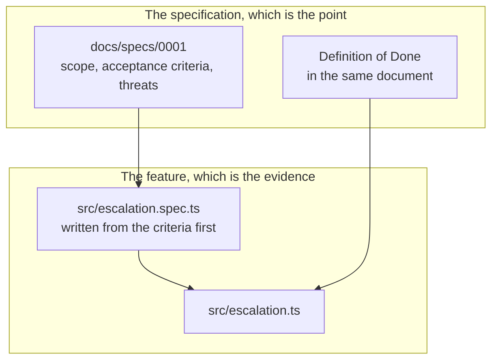

# Architecture

Two layers, and the unusual thing is that the specification is the product and the code is
the evidence.

## The feature

One pure module. `nextEscalation` takes negotiators, deliveries and a time, and returns one of
four decisions: notify, wait, suppressed or exhausted.

Three requirements pull against each other, which is why this feature was chosen rather
than something simpler:

- **Escalation** walks a priority chain with a timing window
- **Duplicate prevention** must survive the scheduler overlapping with itself
- **PII protection** must hold in the message, in the logs and in the audit record

A feature with one requirement would not have produced the interaction bug described in
[TESTING.md](TESTING.md), which is the most instructive thing here.

## Why the decision is a pure function

Time is a parameter. That makes the escalation window assertable without waiting three
minutes, and it is what made the timing bug visible: a skipped unreachable negotiator was
starting the window for a message that had never been sent.

A `SafeMessage` type carries the PII rule rather than a convention. First names, a body, a
scoped token, and structurally nowhere to put an address. A type is a rule the compiler
enforces; a convention is a rule somebody has to remember.

## Redaction as a safety net, not a permission

`redactForLog` matches sensitive key names at any depth, so passing a whole request object
to a log call produces a redacted line rather than an enquiry.

It exists because developers log whole objects under pressure and the safe outcome has to
be the default one. The actual rule is still `escalationLogFields`: build the payload
explicitly from identifiers, so nobody has a reason to reach for a value.

Two mechanisms, because the first is what should happen and the second is what catches it
when it does not.

## What is deliberately absent

No HTTP surface, no database, no queue, no UI. This is one vertical slice, and a larger
surface would bury the specification work the repository exists to show.

The consequence, stated plainly: two of the ten engineering checks this portfolio applies,
integration and end-to-end tests, are not applicable here, and the README says so rather
than describing them in a way that implies otherwise.
