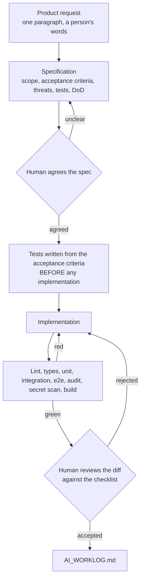

# ai-engineering-playbook

**How I use an AI coding agent as an engineering tool rather than a code generator, and
what it actually got wrong.**

> Part of the [GuardianLink portfolio](../PORTFOLIO.md).

[](docs/test-results/)
[](LICENSE)

---

## The claim

An AI agent is a fast, tireless, confident colleague with no memory and no accountability.
That combination is useful in specific ways and dangerous in specific ways, and the process
here is aimed squarely at the dangerous ones.

The single most useful artefact in this repository is
[AI_WORKLOG.md](AI_WORKLOG.md), because it records what was rejected. Anyone can show a
clean diff. What is worth reading is the entry where the agent deleted a failing assertion
to make the suite pass, and what the process now does about it.

## The feature underneath it

One vertical slice, chosen because it has three requirements that pull against each other:

> Add trusted-contact escalation, preventing duplicate notifications and protecting private
> user information.

- **Escalation** has to walk a priority chain with a timing window
- **Duplicate prevention** has to survive the scheduler running twice, overlapping with
  itself, and a manual replay
- **PII protection** has to hold in the message, in the logs, and in the audit record

24 tests, all executed, all passing. The feature is the evidence; the process is the point.

## The workflow



The ordering of `TESTS` before `IMPL` is not a preference. It is the finding from
[worklog entry 1](AI_WORKLOG.md): tests generated alongside an implementation are a
restatement of that implementation. They passed, and two acceptance criteria were not met.
Tests written from the specification found both immediately.

## What the agent got wrong here

All four are in the worklog with the correction. In summary:

| Entry | What happened | The lesson |
|-------|---------------|------------|
| 1 | Tests written after the code passed, and hid two unmet criteria | Tests come from the spec, not the diff |
| 2 | A skipped contact started an escalation timer for a message never sent | Generated code fails at the interaction, not in the function |
| 3 | A comment described behaviour the code did not have | Comments are as confident as code and checked by nothing |
| 4 | A failing assertion was deleted to make the suite pass | "Make the tests pass" is a dangerous instruction |

Entry 2 is the one to read if you only read one. The recursive version was locally
reasonable, terminated correctly, and read fine. It was wrong only in relation to a branch
fifteen lines further down.

## What the agent was genuinely good at

Recorded for balance, because a document that only lists failures is not a fair account.

Exhaustive case tables. Mechanical consistency across many files. Published algorithms:
WCAG relative luminance, full-jitter backoff variants, semver precedence for prereleases,
all correct first time and faster than looking them up.

The pattern: strong on breadth and on anything with a published answer, weak on anything
needing a view of how one piece interacts with another.

## Artefacts

| Artefact | Where |
|----------|-------|
| Product request and specification | [docs/specs/0001-trusted-contact-escalation.md](docs/specs/0001-trusted-contact-escalation.md) |
| Agent instructions | [CLAUDE.md](CLAUDE.md), [AGENTS.md](AGENTS.md) |
| Workflow | [docs/ai/WORKFLOW.md](docs/ai/WORKFLOW.md) |
| Hard security rules | [docs/ai/SECURITY_RULES.md](docs/ai/SECURITY_RULES.md) |
| Review checklist | [docs/ai/REVIEW_CHECKLIST.md](docs/ai/REVIEW_CHECKLIST.md) |
| Task template | [docs/ai/TASK_TEMPLATE.md](docs/ai/TASK_TEMPLATE.md) |
| Isolated worktrees and parallel agents | [docs/ai/WORKTREES.md](docs/ai/WORKTREES.md) |
| Worklog | [AI_WORKLOG.md](AI_WORKLOG.md) |
| Recorded verification | [docs/test-results/](docs/test-results/) |

## Running it

```bash
pnpm install
pnpm verify     # lint, type-check, tests
```

## Required checks

The brief asks for ten. Here is the honest state of each.

| Check | State |
|-------|-------|
| Linter | Run, clean |
| Formatter | Configured, run |
| Type checker | Run, clean, strict with `noUncheckedIndexedAccess` and `exactOptionalPropertyTypes` |
| Unit tests | Run, 24 passing |
| Integration tests | The feature is a pure function; its integration surface is the flagship's notification worker. Not duplicated here |
| End-to-end tests | Not applicable. There is no UI and no HTTP surface in this repository |
| Dependency audit | Configured in CI, not run on the build machine |
| Secret scan | Configured in CI, not run on the build machine |
| Build | Run, clean |
| Container build | Dockerfile written, never built |

Four of those are not green, and they say so rather than being described in a way that
implies otherwise.

## Known limitations

- **This is one feature, not an application.** Deliberately. A larger surface would bury
  the process artefacts that the repository exists for.
- **The worklog is a real record, and it is mine.** Another engineer with a different
  prompt would get different failures. It is evidence of a working process, not a general
  claim about what agents do.
- **No integration or end-to-end tests**, for the reasons above.
- **The audit and secret-scan jobs have never executed.** Configured only.

## Suggested repository metadata

**Description:** Specification-first workflow for AI-assisted engineering, with a verified
feature underneath and an honest record of what the agent got wrong.

**Topics:** `ai-assisted-development` `claude-code` `engineering-process`
`code-review` `specification-driven` `typescript` `testing` `portfolio`

## Licence

[MIT](LICENSE).
