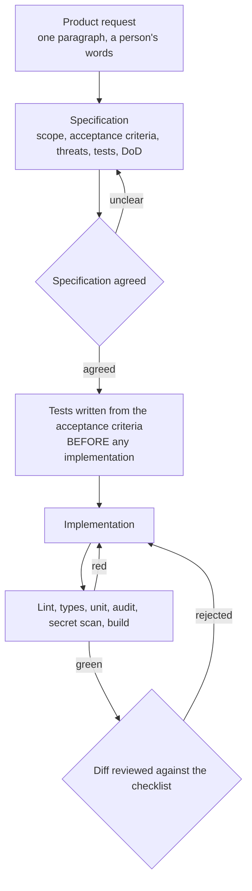

# estateflow-property-portal

**One slice of a property portal, built specification-first: what the process is, and the
three bugs it caught that a reasonable-looking implementation had already passed.**

> A demonstration, not a portal any branch runs on.

> **A reconstruction, not an employer's codebase.** I worked on property software in 2016
> and 2017. The slice here is the one that mattered on a Monday morning: an enquiry comes
> in, a negotiator has a window to pick it up, and if nobody does it goes to the branch
> manager, without the enquirer being messaged four times and without their details ending
> up in a log. Written from scratch for the portfolio; nothing came from an employer.
>
> **The original was ASP.NET MVC 5 and C#**, on SQL Server with Entity Framework 6, with
> jQuery and Bootstrap 3 on the front end. This is a modern TypeScript reconstruction. The
> escalation rules are what the repository is about, and rebuilding them on 2016 tooling
> would have been a lot of work that showed nothing about the rules, so I kept the working
> implementation and said so here.

[](docs/test-results/)
[](LICENSE)

---

## The claim

A specification is worth writing when it can disagree with the code. Most cannot: they are
written after the fact, or in language vague enough that any implementation satisfies them.
One with numbered acceptance criteria, turned into tests before the implementation exists,
can disagree, and on this feature it disagreed three times.

That is the whole argument here, and the evidence is in [TESTING.md](TESTING.md) rather
than in an assertion that the process works.

## The feature underneath it

One vertical slice, chosen because it has three requirements that pull against each other:

> Route a new property enquiry to the assigned negotiator, escalate it to the branch
> manager if nobody picks it up, without notifying anyone twice and without leaking the
> enquirer's details.

- **Escalation** has to walk a priority chain with a timing window
- **Duplicate prevention** has to survive the scheduler running twice, overlapping with
  itself, and a manual replay
- **PII protection** has to hold in the message, in the logs, and in the audit record

24 tests, all executed, all passing. The feature is the evidence; the process is the point.

## The workflow



The ordering of `TESTS` before `IMPL` is not a preference. Tests written alongside an
implementation are a restatement of that implementation. They passed here, and two
acceptance criteria were not met. Tests written from the specification found both
immediately, and then a third nobody had looked for.

## The three bugs the ordering caught

Each is described in full in [TESTING.md](TESTING.md).

| # | What was wrong | Why the ordering caught it |
|---|----------------|----------------------------|
| 1 | The escalation window was measured from the enquiry, not from the last send | AC3 says "from the last send". A test written from the code asserted the code |
| 2 | A skipped unreachable negotiator started the window for a message never sent | AC4 says "without stalling the chain", so a test existed for a case nobody would have thought to write |
| 3 | A refactor put `displayName` back into the log payload | AC5 forbids it, and the assertion was already there to fail |

Bug 2 is the one to read. The implementation was locally reasonable, terminated correctly,
and read fine. It was wrong only in relation to a branch fifteen lines further down, which
is the class of defect that reading a diff does not find.

## Artefacts

| Artefact | Where |
|----------|-------|
| Product request and specification | [docs/specs/0001-enquiry-escalation.md](docs/specs/0001-enquiry-escalation.md) |
| Review checklist | [.github/pull_request_template.md](.github/pull_request_template.md) |
| Testing strategy and the three bugs | [TESTING.md](TESTING.md) |
| Recorded verification | [docs/test-results/](docs/test-results/) |

## Running it

```bash
pnpm install
pnpm verify     # lint, type-check, tests
```

## Engineering checks

Ten checks are applied across this portfolio. Here is the honest state of each here.

| Check | State |
|-------|-------|
| Linter | Run, clean |
| Formatter | Configured, run |
| Type checker | Run, clean, strict with `noUncheckedIndexedAccess` and `exactOptionalPropertyTypes` |
| Unit tests | Run, 24 passing |
| Integration tests | The feature is a pure function. Its integration surface is a notification worker, which is not in this repository |
| End-to-end tests | Not applicable. There is no UI and no HTTP surface in this repository |
| Dependency audit | Configured in CI, not run on the build machine |
| Secret scan | Configured in CI, not run on the build machine |
| Build | Run, clean |
| Container build | Built and run. The image loads the escalation module and exits |

Three of those are not green, and they say so rather than being described in a way that
implies otherwise.

## Known limitations

- **This is one feature, not an application.** Deliberately. A larger surface would bury
  the specification work that the repository exists for.
- **No integration or end-to-end tests**, for the reasons above.
- **The audit and secret-scan jobs have never executed.** Configured only.
- **The link token is a placeholder.** `enquiryId:negotiatorId`, unsigned. A real host signs
  and expires it, and the source says so where it is built.

## Suggested repository metadata

**Description:** Property enquiry routing and escalation, built specification-first, with
the bugs that ordering caught recorded rather than quietly fixed.

**Topics:** `typescript` `specification-driven` `engineering-process` `testing`
`code-review` `privacy` `portfolio`

## Licence

[MIT](LICENSE).
