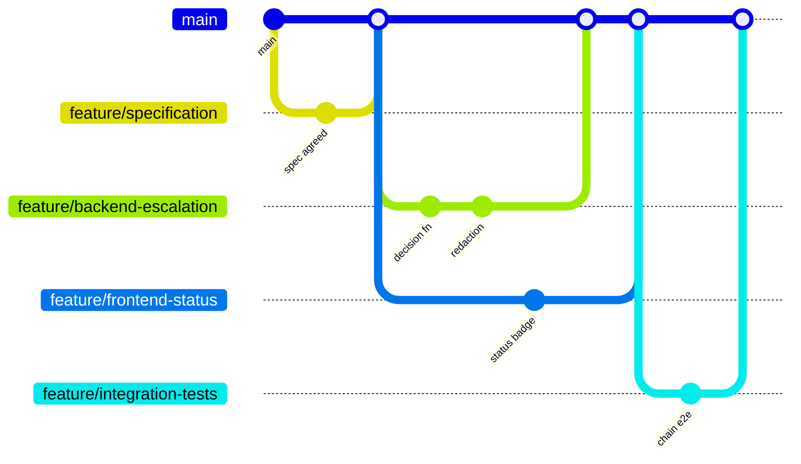

# Isolated worktrees and parallel agents

Running several agents at once is useful and it is also the fastest way to produce a
repository where nobody can tell which change broke what. Worktrees are the answer: each
agent gets its own checkout of the same repository, on its own branch, in its own
directory.

## The setup

```bash
git worktree add ../wt-spec            feature/specification
git worktree add ../wt-backend         feature/backend-escalation
git worktree add ../wt-frontend        feature/frontend-status
git worktree add ../wt-integration     feature/integration-tests

git worktree list
```

Four directories, one `.git`. No stashing, no branch switching, no agent finding the file
it is editing changed underneath it.



## The rule that makes it work

**The specification branch merges first, alone.**

Everything downstream depends on the acceptance criteria being settled. Two agents working
from two versions of a spec produce two implementations that each look correct and do not
fit together. That is not a merge conflict, which git would tell you about; it is a
semantic conflict, which nothing tells you about.

## Splitting work so agents do not collide

Split by **file ownership**, not by feature area. Two agents told to "work on escalation"
will both edit the same file.

| Branch | Owns | Must not touch |
|--------|------|----------------|
| `feature/specification` | `docs/specs/**` | Anything in `src/` |
| `feature/backend-escalation` | `src/escalation.ts` | Tests, docs |
| `feature/frontend-status` | `src/ui/**` | `src/escalation.ts` |
| `feature/integration-tests` | `src/**/*.spec.ts` | Implementation files |

Written into the task given to each agent, explicitly. An agent that is told what it owns
stays inside it; an agent that is told what to build does not.

## Running them

```bash
cd ../wt-backend    && claude "Implement docs/specs/0001, backend only. You own src/escalation.ts. Do not edit tests."
cd ../wt-frontend   && claude "Implement the status badge from docs/specs/0001. You own src/ui/. Do not edit src/escalation.ts."
```

Each verifies in its own worktree before anything merges:

```bash
pnpm install && pnpm verify
```

## Merging

1. Specification first, alone.
2. Then implementation branches, one at a time, running the full suite between each.
3. Integration tests last, because they are the thing that proves the pieces fit.

Running the suite between merges rather than after all of them is the difference between
"branch three broke it" and "something in these four branches broke it".

## Cleaning up

```bash
git worktree remove ../wt-backend
git worktree prune
```

A stale worktree entry pointing at a deleted directory produces confusing errors months
later. `prune` is cheap.

## When not to do this

Parallel agents are worth the coordination cost when the work genuinely splits along file
boundaries. They are not worth it when:

- The task is small enough for one agent. Most tasks are.
- The pieces are coupled. Two agents on two sides of one interface will each invent it.
- You cannot review the output fast enough. Four agents producing diffs faster than one
  person can read them is not throughput, it is a backlog with extra steps.

The bottleneck in AI-assisted development is review, not generation. Parallelism helps only
when generation is genuinely what is slow.

## What was actually used here

This feature was built by **one agent, sequentially**, because it is one file. The worktree
workflow above is documented and has been used on the flagship, where the backend, web and
mobile surfaces genuinely are separate files with separate owners.

Saying that plainly matters: describing a parallel workflow and implying it was used on a
two-hundred-line feature would be exactly the kind of overstatement this repository exists
to argue against.
